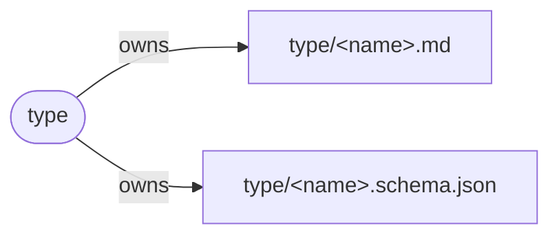

A type defines a kind of thing and the files each of its instances **owns** (creates and manages, exactly one owner), **writes** (modifies without owning) and **watches** (reads, wants to know about changes). `<name>` in a path is the instance's name.

<Note>Ported from `dash-skogai/README.md` in the skogai repo as a Mintlify test page.</Note>

## Types

| Type | Summary |
| --- | --- |
| `type` | A kind of thing, and the files each of its instances owns, writes and watches. |
| `decision` | A choice and why it was made, written once. |
| `rule` | A constraint that can be checked, enforcing a decision. |
| `trigger` | A script that runs when a file changes or an event happens. |
| `tool` | An executable skogai uses, with its wrapper, scripts and workflow. |
| `event` | Something that happened, recorded as one row appended to the event log. |
| `router` | A file that points to other files, so an agent loads only what the task needs. |

`task`, `knowledge`, `memory`, `repo` and `spec` are stubs with no definition yet.

## Ownership rules

<Steps>
  <Step title="Every file has one owner">
    A file with no owner is untyped, and a file with two owners is a conflict. Both are errors.
  </Step>
  <Step title="Ownership is one step">
    `type` owns `type/tool.md`; `tool` owns `type/tool/gita.md`. `type` never owns what is under `type/tool/`.
  </Step>
  <Step title="Writes and watches overlap freely">
    Only ownership is exclusive.
  </Step>
</Steps>

## Example: the type type

`type` is itself a type: every `type/<name>.md` is an instance of it.

